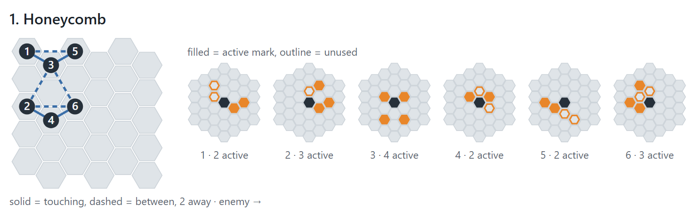
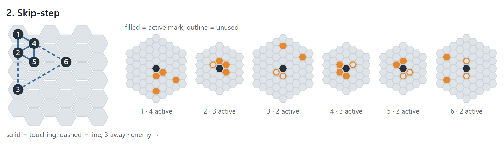
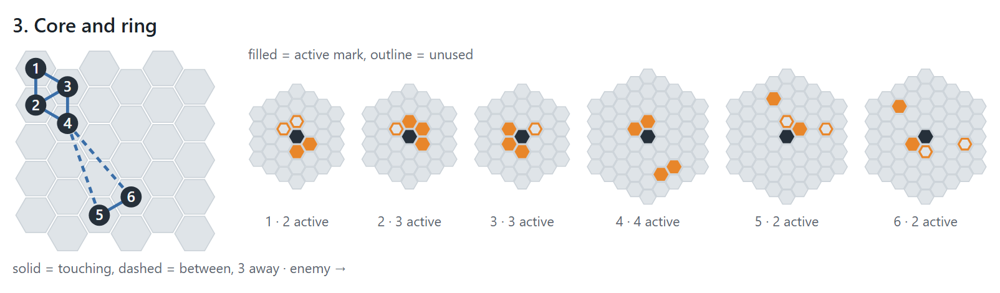
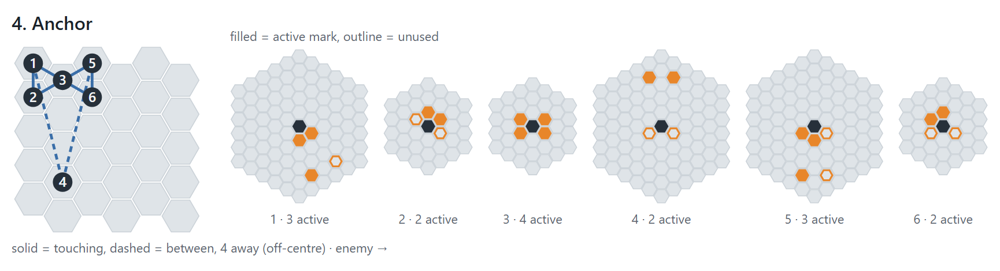
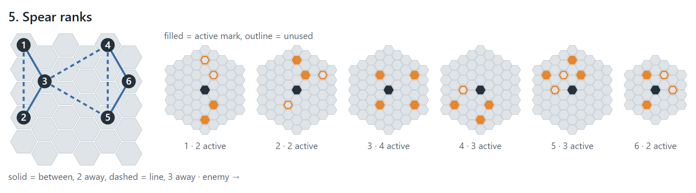
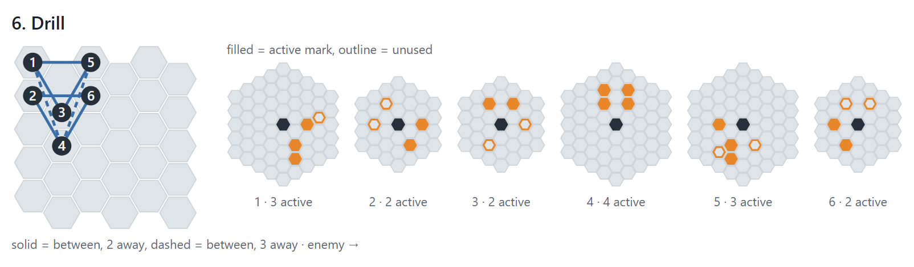
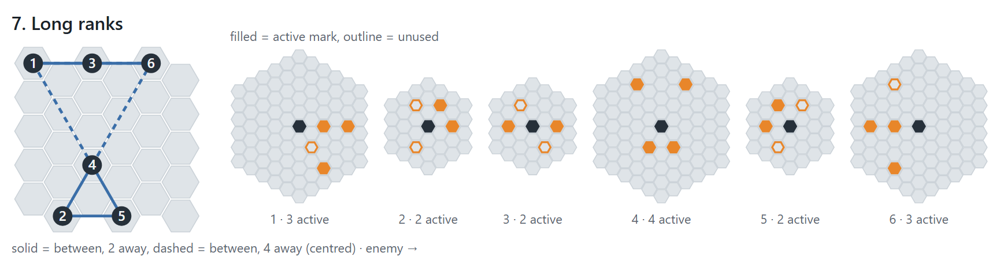
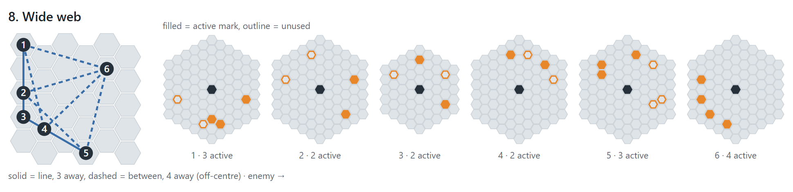
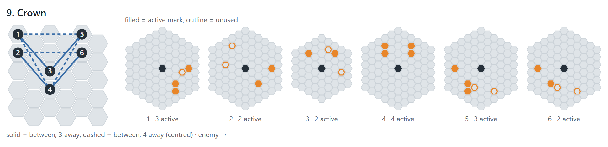
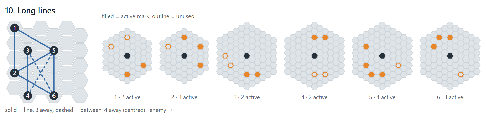

# 10 team comps by AI (marks only)

(Sub-page of Team comp design.)

1. <b>Honeycomb: touching + between, 2 away</b>

2. <b>Skip-step: touching + line, 3 away</b>

3. <b>Core and ring: touching + between, 3 away</b>

4. <b>Anchor: touching + between, 4 away</b>

5. <b>Spear ranks: between, 2 away + line, 3 away</b>

6. Drill: between, 2 away + between, 3 away

7. Long ranks: between, 2 away + between, 4 away

8. Wide web: line, 3 away + between, 4 away

9. Crown: between, 3 away + between, 4 away

10. Long lines: line, 3 away + between, 4 away

Full report: https://claude.ai/artifact/7BZ9rgXJHYTnfLuCiRp7Mt
