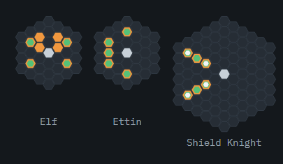
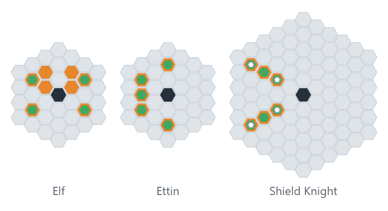
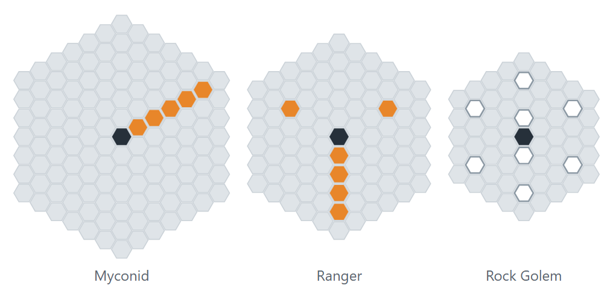
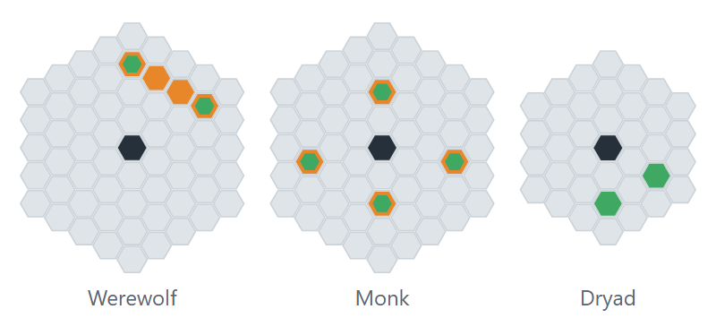
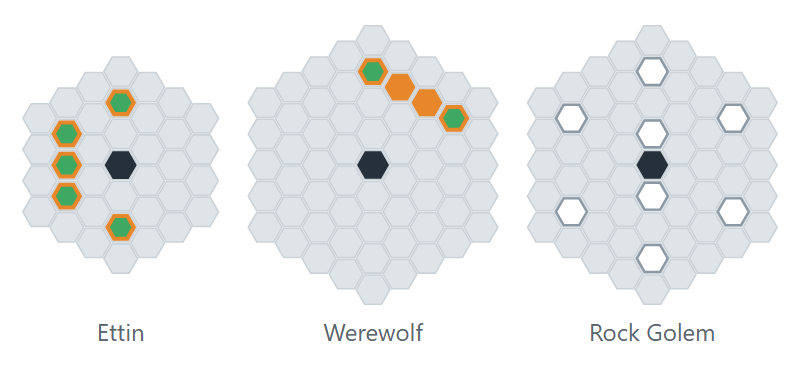
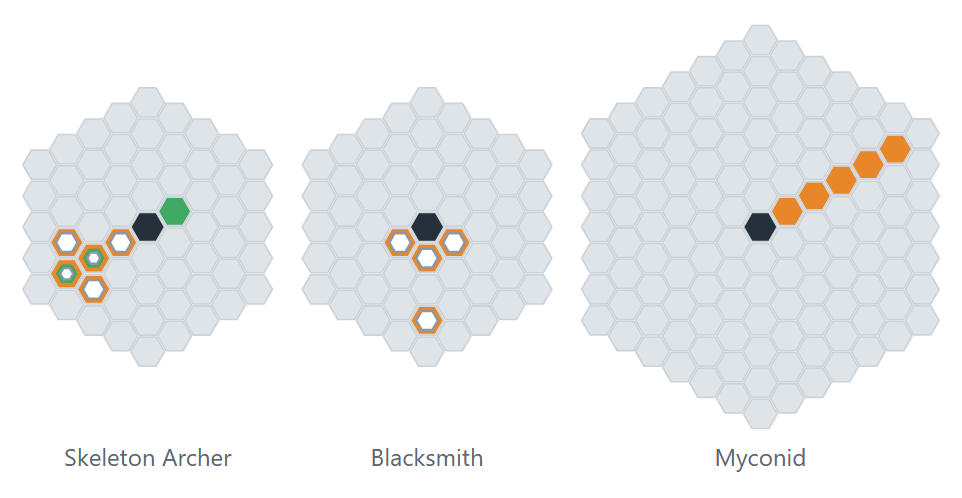
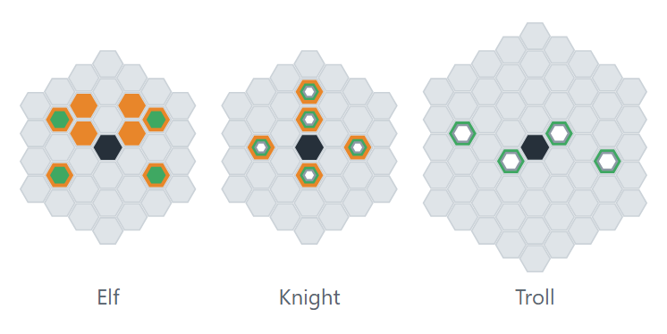
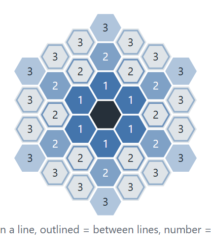

# 🔷 Mark layout

---

<h1 color="blue">
What make mark layout pretty
</h1>

1. Mirror it:

2. Build from straight lines and rings.

3. Keep it small: 4 to 8 hexes, 6 is the middle.

4. Space the hexes evenly (e.g. all 2 away, or 1 and 3).

5. Draw something the hero is (Skeleton's arrow, Myconid's beam).

6. Stack colours on the same hexes. Green shares orange's hexes, or a mirrored part of them.

7. Shape first, formation second.

---

<h1 color="blue">
What make mark layout distinct to other hero
</h1>

1. Spacing: how far the hexes are from the hero (1, 2, 3, 4).
2. On a line, or between lines.
3. Shape.

---

<h1 color="blue">
What make heroes synergized
</h1>

1. Only mutual marks count: each stands on the other's mark.
2. Mutual needs a shared slot: same spacing, same kind (line or between).
3. Fewer spacings, pickier hero. Keep each hero to 1-2 spacings.
4. Each team gets a home slot (Elf: on a line, 2 away).
